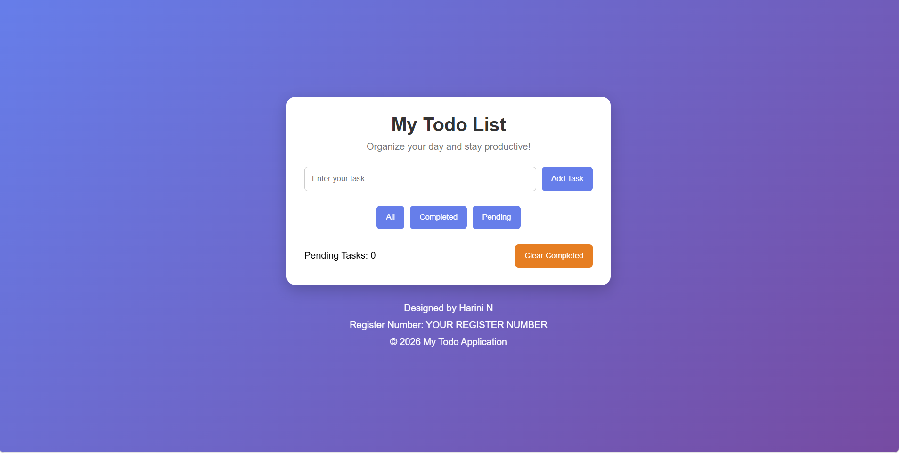

# Ex.03-Todo-Application-with-All-Features-Using-JavaScript

## Date:
17/11/2026

## AIM

To create a To-do Application with all features using HTML, CSS, and JavaScript.

## ALGORITHM

### STEP 1
Create an HTML file (`index.html`) to define the structure of the To-do Application.

### STEP 2
Create a CSS file (`style.css`) to design and style the application.

### STEP 3
Plan the features required for the To-do Application, such as adding, deleting, completing, and filtering tasks.

### STEP 4
Create the To-do Application using JavaScript (`script.js`).

### STEP 5
Add functionalities to add new tasks, mark tasks as completed, delete tasks, and filter tasks.

### STEP 6
Use Local Storage to save tasks even after refreshing the webpage.

### STEP 7
Test all the application features to ensure they work correctly.

### STEP 8
Open the HTML file in a web browser and check the layout and functionality.

### STEP 9
Fix styling issues and improve the application design and responsiveness.

### STEP 10
Upload the project files to GitHub and deploy the website using GitHub Pages.

## PROGRAM
index
```

<!DOCTYPE html>
<html lang="en">
<head>
    <meta charset="UTF-8">
    <meta name="viewport" content="width=device-width, initial-scale=1.0">
    <title>My Todo Application</title>
    <link rel="stylesheet" href="style.css">
</head>
<body>

    <div class="container">
        <h1>My Todo List</h1>
        <p class="subtitle">Organize your day and stay productive!</p>

        <div class="input-section">
            <input type="text" id="taskInput"
                   placeholder="Enter your task...">
            <button onclick="addTask()">Add Task</button>
        </div>

        <div class="filters">
            <button onclick="showTasks('all')">All</button>
            <button onclick="showTasks('completed')">Completed</button>
            <button onclick="showTasks('pending')">Pending</button>
        </div>

        <ul id="taskList"></ul>

        <div class="bottom-section">
            <p id="taskCount">No tasks available</p>
            <button class="clear-btn" onclick="clearCompleted()">
                Clear Completed
            </button>
        </div>
    </div>

    <footer>
        <p>Designed by Harini N</p>
        <p>Register Number: YOUR REGISTER NUMBER</p>
        <p>© 2026 My Todo Application</p>
    </footer>

    <script src="script.js"></script>
</body>
</html>
```
style
```

* {
    margin: 0;
    padding: 0;
    box-sizing: border-box;
}

body {
    font-family: Arial, sans-serif;
    background: linear-gradient(135deg, #667eea, #764ba2);
    min-height: 100vh;
    display: flex;
    flex-direction: column;
    align-items: center;
    justify-content: center;
    padding: 30px 15px;
}

.container {
    background: white;
    width: 100%;
    max-width: 550px;
    padding: 30px;
    border-radius: 15px;
    box-shadow: 0 8px 25px rgba(0,0,0,0.2);
}

h1 {
    text-align: center;
    color: #333;
    margin-bottom: 10px;
}

.subtitle {
    text-align: center;
    color: #777;
    margin-bottom: 25px;
}

.input-section {
    display: flex;
    gap: 10px;
}

input {
    flex: 1;
    min-width: 0;
    padding: 12px;
    border: 1px solid #ccc;
    border-radius: 6px;
    outline: none;
}

button {
    padding: 12px 16px;
    background: #667eea;
    color: white;
    border: none;
    border-radius: 6px;
    cursor: pointer;
}

button:hover {
    background: #4b5ecb;
}

.filters {
    display: flex;
    justify-content: center;
    gap: 10px;
    margin: 25px 0;
}

#taskList {
    list-style: none;
}

#taskList li {
    background: #f3f4f8;
    margin-bottom: 10px;
    padding: 12px;
    border-radius: 7px;
    display: flex;
    align-items: center;
    justify-content: space-between;
    gap: 10px;
}

.task-text {
    flex: 1;
    overflow-wrap: anywhere;
}

.completed {
    text-decoration: line-through;
    color: gray;
}

.task-actions {
    display: flex;
    gap: 5px;
}

.task-actions button {
    padding: 7px 10px;
}

.delete-btn {
    background: #e74c3c;
}

.delete-btn:hover {
    background: #c0392b;
}

.bottom-section {
    display: flex;
    justify-content: space-between;
    align-items: center;
    gap: 10px;
    margin-top: 20px;
    flex-wrap: wrap;
}

.clear-btn {
    background: #e67e22;
}

footer {
    color: white;
    text-align: center;
    margin-top: 25px;
    line-height: 1.8;
}

@media (max-width: 480px) {
    .container {
        padding: 20px;
    }

    .input-section {
        flex-direction: column;
    }

    .filters button {
        padding: 10px;
    }
}
```
script
```

let tasks = JSON.parse(localStorage.getItem("tasks")) || [];
let currentFilter = "all";

function saveTasks() {
    localStorage.setItem("tasks", JSON.stringify(tasks));
}

function addTask() {
    let input = document.getElementById("taskInput");
    let taskName = input.value.trim();

    if (taskName === "") {
        alert("Please enter a task!");
        return;
    }

    let task = {
        id: Date.now(),
        text: taskName,
        completed: false
    };

    tasks.push(task);
    input.value = "";

    saveTasks();
    displayTasks();
}

function displayTasks() {
    let taskList = document.getElementById("taskList");
    taskList.innerHTML = "";

    let filteredTasks = tasks.filter(task => {
        if (currentFilter === "completed") {
            return task.completed;
        }

        if (currentFilter === "pending") {
            return !task.completed;
        }

        return true;
    });

    filteredTasks.forEach(task => {
        let li = document.createElement("li");

        let span = document.createElement("span");
        span.textContent = task.text;
        span.className = task.completed
            ? "task-text completed"
            : "task-text";

        let actions = document.createElement("div");
        actions.className = "task-actions";

        let completeBtn = document.createElement("button");
        completeBtn.textContent = task.completed
            ? "Undo"
            : "Done";

        completeBtn.onclick = () => toggleTask(task.id);

        let deleteBtn = document.createElement("button");
        deleteBtn.textContent = "Delete";
        deleteBtn.className = "delete-btn";
        deleteBtn.onclick = () => deleteTask(task.id);

        actions.appendChild(completeBtn);
        actions.appendChild(deleteBtn);

        li.appendChild(span);
        li.appendChild(actions);

        taskList.appendChild(li);
    });

    updateCount();
}

function toggleTask(id) {
    tasks = tasks.map(task => {
        if (task.id === id) {
            task.completed = !task.completed;
        }
        return task;
    });

    saveTasks();
    displayTasks();
}

function deleteTask(id) {
    tasks = tasks.filter(task => task.id !== id);

    saveTasks();
    displayTasks();
}

function showTasks(filter) {
    currentFilter = filter;
    displayTasks();
}

function clearCompleted() {
    tasks = tasks.filter(task => !task.completed);

    saveTasks();
    displayTasks();
}

function updateCount() {
    let pending = tasks.filter(task => !task.completed).length;

    document.getElementById("taskCount").textContent =
        "Pending Tasks: " + pending;
}

document.getElementById("taskInput").addEventListener(
    "keypress", function(event) {
        if (event.key === "Enter") {
            addTask();
        }
    }
);

displayTasks();
```

## OUTPUT


## RESULT

Thus, the To-do Application with all features using JavaScript was created and executed successfully. The application allows users to add, manage, complete, delete, and filter tasks efficiently using HTML, CSS, and JavaScript.